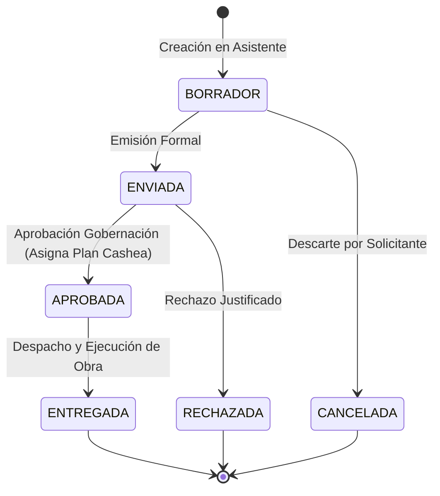

# SICOP-VE: Sistema de Cotización y Control Presupuestario para Obras en Venezuela

**Proyecto Final — Cátedra de Lógica y Algoritmos / Programación I**  
*Universidad Nacional Experimental de las Ciencias (UNC)*  
*Desarrollado en HTML5, CSS3 y JavaScript Puro (Vanilla JS ES5).*  
*Versión:* **v7.3 Auditoría Integral y Optimización Definitiva**  
*Estado de Pruebas:* **60/60 Pruebas Automáticas en Verde (100% aprobadas, 0 fallidas)**

---

## 📑 Tabla de Contenidos
1. [Descripción General y Problema que Resuelve](#1-descripción-general-y-problema-que-resuelve)
2. [Instrucciones de Ejecución Offline](#2-instrucciones-de-ejecución-offline)
3. [Credenciales y Usuarios de Demostración](#3-credenciales-y-usuarios-de-demostración)
4. [Estructura del Proyecto y Arquitectura](#4-estructura-del-proyecto-y-arquitectura)
5. [Decisiones de Diseño y Experiencia de Usuario (UI/UX)](#5-decisiones-de-diseño-y-experiencia-de-usuario-uiux)
6. [Catálogo Maestro, Fletes y Plantillas de Obra](#6-catálogo-maestro-fletes-y-plantillas-de-obra)
7. [Sistema de Financiamiento Cashea y Cobranzas](#7-sistema-de-financiamiento-cashea-y-cobranzas)
8. [Explicación Detallada de Módulos y Reglas de Negocio](#8-explicación-detallada-de-módulos-y-reglas-de-negocio)
9. [Fórmulas Presupuestarias y Ejemplo Numérico](#9-fórmulas-presupuestarias-y-ejemplo-numérico)
10. [Ciclo de Vida de una Cotización y Firma Digital](#10-ciclo-de-vida-de-una-cotización-y-firma-digital)
11. [Herramientas Avanzadas v4.0](#11-herramientas-avanzadas-v40)
12. [Matriz de Roles y Permisos](#12-matriz-de-roles-y-permisos)
13. [Batería de Pruebas Automáticas (60 Casos)](#13-batería-de-pruebas-automáticas-60-casos)
14. [Guía para la Exposición y Defensa del Proyecto](#14-guía-para-la-exposición-y-defensa-del-proyecto)
15. [Publicación en GitHub Pages](#15-publicación-en-github-pages)

---

## 1. Descripción General y Problema que Resuelve

En el sector de obras civiles, infraestructura pública y proyectos comunitarios en Venezuela, la estimación de costos y el control presupuestario enfrentan desafíos estructurales únicos:
- **Dispersión geográfica de precios:** La adquisición de insumos industriales (cemento, cabillas, asfalto, transformadores) presenta variaciones considerables según el centro de distribución o polo petroquímico y siderúrgico (e.g. Puerto Ordaz vs. Caracas o Maracaibo).
- **Sobrecostos de flete terrestre:** La distancia logística hacia estados occidentales, andinos o del sur (Zulia, Mérida, Táchira, Amazonas) encarece significativamente el traslado respecto a la región central.
- **Inflación y volatilidad cambiaria:** Obliga a presupuestar en divisa de referencia (USD) y convertir a Bolívares (Bs.) en tiempo real empleando la tasa oficial del Banco Central de Venezuela (BCV).
- **Trazabilidad y disciplina presupuestaria:** Entidades públicas (Alcaldías, Gobernaciones, Comunas) y empresas contratistas requieren supervisar estrictamente saldos disponibles, fondos comprometidos y gasto ejecutado para evitar déficits antes de autorizar obras.
- **Acceso a financiamiento por etapas:** Incorporación de esquemas de pago a plazos (tipo Cashea y créditos institucionales) con cálculo automático de inicial, cuotas quincenales/mensuales y protección de mora.

**SICOP-VE** resuelve estos desafíos mediante un sistema web integrado, rápido, accesible, 100% offline y pedagógico, diseñado bajo estándares modernos de usabilidad y código Vanilla JavaScript puro.

---

## 2. Instrucciones de Ejecución Offline

El sistema no requiere Node.js, Python, XAMPP, servidores web ni dependencias de npm:
1. Descargue o clone el repositorio en su computadora.
2. Haga **doble clic directamente en `index.html`** para abrir la plataforma en cualquier navegador web moderno (Google Chrome, Microsoft Edge, Mozilla Firefox, Safari, Brave) bajo el protocolo nativo `file://`.
3. Para validar la batería completa de pruebas unitarias y de integración, abra **`pruebas.html`**. El motor ejecutará automáticamente los **60 casos de prueba** y presentará el reporte en verde.

---

## 3. Credenciales y Usuarios de Demostración

El sistema incluye **10 usuarios precargados** que modelan toda la jerarquía institucional, solicitantes y supervisores de Gobernación:

| N° | Nombre Completo | Usuario | Clave | Perfil Institucional | Estado Destino | Límite / Cupo (USD) | Rol en Plataforma |
|:--:|:----------------|:--------|:------|:---------------------|:---------------|:--------------------|:-------------------|
| 1 | María González | `alcaldia_libertador` | `1234` | Alcaldía | Distrito Capital | $35.000,00 | Solicitante (Nivel 3) |
| 2 | Carlos Rodríguez | `constructora_valencia`| `1234` | Empresa | Carabobo | $36.000,00 | Solicitante (Nivel 4) |
| 3 | José Martínez | `maestro_martinez` | `1234` | Constructor | Zulia | $5.500,00 | Solicitante (Nivel 2) |
| 4 | Ing. Ana Pérez | `gobernacion_miranda` | `admin123` | Gobernación | Miranda | $90.000,00 | Supervisor / Aprobador 1 (Nivel 5) |
| 5 | Luis Hernández | `vialidad_merida` | `1234` | Empresa | Mérida | $6.750,00 | Solicitante (Nivel 1 - En Mora) |
| 6 | Pedro Castillo | `alcaldia_iribarren` | `1234` | Alcaldía | Lara | $20.000,00 | Solicitante (Nivel 2) |
| 7 | Ing. Marcos Rivas | `gobernacion_zulia` | `admin123` | Gobernación | Zulia | $90.000,00 | Supervisor / Aprobador 2 (Nivel 5) |
| 8 | Elena Blanco | `comuna_panamericana` | `1234` | Constructor | Táchira | $4.500,00 | Solicitante (Nivel 2) |
| 9 | Ing. Elena Blanco | `gobernacion_carabobo` | `admin123` | Gobernación | Carabobo | $90.000,00 | Supervisor / Aprobador 3 (Nivel 5) |
| 10 | Ing. Rafael Sosa | `gobernacion_anzoategui` | `admin123` | Gobernación | Anzoátegui | $90.000,00 | Supervisor / Aprobador 4 (Nivel 5) |

> **Nota de Acceso Rápido:** La pantalla de inicio de sesión dispone de una cuadrícula de botones para demostración que permite autocompletar credenciales e iniciar sesión con cualquiera de los 10 usuarios con un solo clic. Para los perfiles de Gobernación la clave es `admin123`, y para los solicitantes es `1234`.

---

## 4. Estructura del Proyecto y Arquitectura

El software implementa una arquitectura desacoplada en capas estrictas sin manipulación cruzada:

```text
SICOP-VE/
├── index.html          # Interfaz principal de la plataforma SaaS y modales
├── estilos.css         # Sistema de diseño editorial, tokens CSS y modo oscuro
├── pruebas.html        # Suite interactiva de pruebas automáticas
├── README.md           # Documentación maestra del sistema
├── docs/
│   └── CAMBIOS.md      # Historial consolidado de cambios de versión
├── img/
│   ├── logo-blanco.png # Imagotipo oficial fondo oscuro
│   ├── logo-negro.png  # Imagotipo oficial fondo claro
│   └── fondo-login.jpg # Fotografía artística de portada
└── js/
    ├── iconos.js       # Biblioteca de 40+ vectores SVG puros en línea
    ├── datos.js        # Constantes, 150 materiales, 30 plantillas y persistencia
    ├── logica.js       # Algoritmos puros de cálculo presupuestario, fletes y mora
    ├── movimiento.js   # Microinteracciones a 60fps, contadores y reloj de Caracas
    ├── interfaz.js     # Controlador del DOM, eventos, modales y renderizado
    ├── comandos.js     # Paleta de comandos accesible (Ctrl+K / Cmd+K)
    ├── comparador.js   # Comparador visual de cotizaciones lado a lado
    ├── analisis-abc.js # Análisis de Pareto ABC con ordenamiento burbuja manual
    ├── tour.js         # Tour interactivo guiado para nuevos usuarios
    └── pruebas.js      # Suite de 50 aserciones automatizadas
```

### Reglas Arquitectónicas Inviolables:
- **`js/datos.js`:** Constantes de negocio, datos semilla y métodos de lectura/escritura en `localStorage`. **Cero manipulación del DOM**.
- **`js/logica.js`:** Funciones puras, cálculo de IVA, contingencia, fletes, descuentos, análisis de solvencia, mora financiera, ordenamiento burbuja y firma digital. **Cero manipulación del DOM**.
- **`js/interfaz.js`:** Enlace exclusivo con la vista, captura de eventos, renderizado dinámico de tablas y gestión accesible de modales.
- **JavaScript ES5 Estricto:** Prohibido el uso de `class`, `let`, `const`, funciones flecha, módulos `import`/`export` y librerías externas. Todo funciona de forma nativa en cualquier navegador.

---

## 5. Decisiones de Diseño y Experiencia de Usuario (UI/UX)

La interfaz adopta una dirección de arte editorial, limpia y sobria:
1. **Paleta Neutra Cálida:** Fondo base en modo claro `#F1F0EC` y modo oscuro `#121211`, evitando el deslumbramiento de blancos puros y negros saturados.
2. **Tipografía Fluida y Jerarquía:** Tipografía de sistema de alta legibilidad (`system-ui`, `-apple-system`, `Segoe UI`, `Roboto`), combinada con números tabulares (`font-variant-numeric: tabular-nums`) para evitar desalineaciones en columnas de cifras monetarias.
3. **Persistencia de Preferencias:** El tema claro/oscuro y la moneda activa (USD / Bs.) se guardan en `localStorage` y se restauran al iniciar sesión.
4. **Accesibilidad WCAG 2.1 AA:** Contraste de texto validado ($\ge 4.5:1$), trampas de foco completas en modales (teclas `Tab`, `Shift+Tab` y `Escape`), labels explícitos asociados por `id`/`for` y atributos `aria-live` en notificaciones.
5. **Cero Diálogos Nativos:** Prohibido el uso de `alert()`, `confirm()` y `prompt()`. El sistema cuenta con modales propios accesibles y toasts emergentes no bloqueantes con opción de "Deshacer".

---

## 6. Catálogo Maestro, Fletes y Plantillas de Obra

### 6.1 Catálogo de 150 Materiales Industriales
El catálogo maestro incluye **150 insumos de construcción** organizados en 6 sectores estratégicos:
1. **Construcción:** Cementos, agregados, bloques, cabillas, perfiles estructurales, mallas, aditivos.
2. **Energía:** Transformadores monofásicos/trifásicos, cables de cobre, postes de concreto, crucetas, aisladores, luminarias LED solares.
3. **Agua:** Tuberías PEAD y PVC de alta presión, válvulas compuerta, bombas sumergibles, tanques industriales.
4. **Vialidad:** Asfalto en caliente, emulsión asfáltica, brocales, ojos de gato reflectivos, pintura termoplástica vial, alcantarillas metálicas.
5. **Acabados:** Cerámica de alto tráfico, pintura elastomérica, impermeabilizantes asfálticos, techos de policarbonato, puertas entamboradas.
6. **Equipos:** Mezcladoras de concreto, compactadoras tipo bailarina, andamios tubulares, generadores eléctricos, motobombas.

### 6.2 Matriz Logística de 18 Estados (Factores de Flete)
El recargo por flete terrestre se calcula según la distancia desde los centros industriales:
- **Caracas / Dto. Capital:** 1.00 (base sin recargo)
- **Miranda / La Guaira / Aragua / Carabobo:** 1.02 - 1.05 (2% a 5%)
- **Anzoátegui / Guárico / Lara / Yaracuy / Falcón:** 1.06 - 1.08 (6% a 8%)
- **Monagas / Bolívar / Zulia / Trujillo / Barinas / Portuguesa:** 1.08 - 1.12 (8% a 12%)
- **Mérida / Táchira / Sucre / Nueva Esparta:** 1.12 - 1.16 (12% a 16%)
- **Amazonas / Delta Amacuro:** 1.20 - 1.22 (20% a 22%)

### 6.3 Ciudades Base (Poder Adquisitivo y Oferta)
12 ciudades con factores de mercado calibrados: Puerto Ordaz (0.90), Valencia (0.95), Barquisimeto (0.97), Maracay (0.98), Maracaibo (1.02), Caracas (1.05), San Cristóbal (1.07), Mérida (1.08), Puerto La Cruz (1.00), Maturín (1.03), Ciudad Bolívar (1.04) y Cumaná (1.06).

### 6.4 30 Plantillas de Obra Preconfiguradas
El asistente incluye **30 proyectos tipo listos para usar en un clic**:
- *Vivienda y Hábitat:* Casa 50m², Casa 70m², Módulo unifamiliar 35m², Reparación de techos 100m².
- *Vialidad y Pavimento:* Bacheo asfáltico 200m², Pavimento rígido concreto 150m², Mantenimiento vial 500m.
- *Redes Hidráulicas:* Red de agua potable 300m, Cloacas y drenajes 150m, Estación de bombeo comunal.
- *Infraestructura Eléctrica:* Electrificación rural 500m, Alumbrado público solar (20 postes), Subestación comunal 50kVA.
- *Equipamiento Social y Deportivo:* Cancha de usos múltiples, Escuela básica (2 aulas), Módulo de salud ambulatorio, Parque infantil bio-saludable, Comedor popular comunitario.
- *Obras Civiles y Muros:* Muro de contención gavión 20m, Acera y brocales 250m, Galpón industrial 200m², Tanque subterráneo 25.000 L.

---

## 7. Sistema de Financiamiento Cashea y Cobranzas

SICOP-VE v7.0 incorpora un motor financiero completo para amortización de compras institucionales:

### 7.1 Planes Disponibles
1. **Contado Inmediato (`contado`):** Pago del 100% al aprobar, sin cuotas posteriores.
2. **Cashea 3 Cuotas (`cashea_3`):** 50% de inicial pagadero al aprobar + 3 cuotas iguales sin interés pagaderas cada 14 días (quincenal).
3. **Cashea 6 Cuotas (`cashea_6`):** 40% de inicial pagadero al aprobar + 6 cuotas iguales sin interés pagaderas cada 14 días.
4. **Crédito Quincenal 6C (`quincenal_6`):** 30% inicial + 5% de recargo administrativo sobre el saldo financiado, distribuido en 6 cuotas quincenales.
5. **Crédito Anual 12C (`mensual_12`):** 20% inicial + 12% de recargo administrativo sobre el saldo financiado, amortizable en 12 cuotas mensuales (cada 30 días).

### 7.2 Protección Antidéficit y Bloqueo por Mora
- **Mora Diaria:** Si una cuota supera su fecha de vencimiento sin ser amortizada, el sistema aplica un recargo por mora del 0.1% diario (`tasaMoraDiaria = 0.001`).
- **Bloqueo de Cotizaciones:** La función `verificarDisponibilidadNuevaCotizacion` evalúa la cartera del usuario. Si posee **cuotas vencidas no pagadas**, se bloquea automáticamente el inicio o aprobación de nuevos presupuestos hasta que regularice su deuda.
- **Módulos de Gestión:**
  - *Mis Cuotas (Todos los usuarios):* Cronograma visual, montos, estados (`AL DÍA`, `VENCIDA`, `PAGADA`), barra de progreso y botón para registrar amortizaciones con número de referencia bancaria.
  - *Cartera Global (Gobernación):* Supervisión general de cobranzas, cartera total emitida, recaudación efectiva, mora activa y tasa de recuperación.

---

## 8. Explicación Detallada de Módulos y Reglas de Negocio

### Módulo 1: Dashboard y Control Presupuestario
- Visualización de saldos en tiempo real: Límite Total, Comprometido (obras aprobadas pendientes de entrega), Ejecutado (obras entregadas) y Saldo Disponible.
- Semáforo Presupuestario automático: Verde (< 70% comprometido), Amarillo (70% a 90%) y Rojo (> 90% o déficit).
- Gráficos estadísticos de inversión por sector y por estado geográfico.
- Feed de auditoría en vivo con las últimas actividades del usuario.
- Acceso directo al Análisis de Pareto ABC de insumos.

### Módulo 2: Asistente de Cotización en 4 Pasos
- **Paso 1 (Datos de la Obra):** Nombre del proyecto ($\ge 4$ caracteres), estado de destino (aplica flete) y punto de compra (aplica factor de ciudad).
- **Paso 2 (Selección de Insumos):** 150 materiales con buscador instantáneo, filtrado por sector y 30 plantillas preconfiguradas. Permite ir y volver a la calculadora técnica.
- **Paso 3 (Revisión y Parámetros):** Desglose pedagógico de Subtotal, Flete, Descuento institucional, Contingencia (5%) e IVA venezolano (16%). Botón didáctico *"¿Cómo se calculó esto?"* que desglosa las fórmulas matemáticas con los valores reales.
- **Paso 4 (Resumen y Emisión):** Verificación de solvencia, guardado definitivo y descarga o impresión del documento formal.
- **Guardado Automático de Borrador:** El asistente guarda automáticamente el progreso en `localStorage` cada 800 ms. Al recargar la página, detecta el borrador del usuario y ofrece restaurarlo.

### Módulo 3: Calculadora Técnica de Rendimiento
Determina cantidades exactas de insumos con porcentaje de desperdicio ajustable (5% a 15%):
- Concreto estructural para losas, columnas y vigas (cemento, arena, piedra y agua).
- Mampostería de bloques de arcilla y cemento con mortero.
- Pintura para muros y fachadas (galones y cuñetes según manos de aplicación).
- Botón directo *"Cargar en Cotizador"* para transferir las cantidades calculadas al presupuesto activo.

### Módulo 4: Dónde Conviene Comprar
- Compara precios de insumos en 12 ciudades venezolanas.
- Ordenamiento mediante **algoritmo manual de burbuja ascendente** (de menor a mayor factor de costo).

### Módulo 5: Catálogo Maestro Editable (Solo Gobernación)
- Altas, bajas y modificaciones de precios base de los 150 materiales.
- Buscador reactivo por texto y filtro por sector.
- Registro inmutable de cada cambio en la bitácora de auditoría.

### Módulo 6: Aprobaciones y Control de Fondos (Solo Gobernación)
- Evaluación de disponibilidad presupuestaria del solicitante.
- Selección del plan de financiamiento (`cashea_3`, `quincenal_6`, `contado`, etc.) al autorizar la cotización.
- Rechazo formal justificado mediante modal accesible (asienta motivo en bitácora).
- Despacho y entrega: Al marcar *"Entregada"*, los fondos pasan de saldo comprometido a gasto definitivo ejecutado.

### Módulo 7: Historial y Comparador de Cotizaciones
- Registro cronológico de todas las solicitudes emitidas.
- Filtro por estado (`BORRADOR`, `ENVIADA`, `APROBADA`, `RECHAZADA`, `ENTREGADA`, `CANCELADA`).
- Opción de duplicar cotizaciones existentes en un clic.
- Cancelación con confirmación y botón emergente de *"Deshacer"*.
- Casillas de selección para comparar de 2 a 4 cotizaciones en el comparador visual.

### Módulo 8: Supervisión Global y Ranking (Solo Gobernación)
- Ranking de entidades ordenadas de mayor a menor inversión mediante **algoritmo manual de burbuja descendente**.
- Totales consolidados por perfil institucional y por estado geográfico.

### Módulo 9: Bitácora de Auditoría y Alertas Tempranas
- Alertas de cotizaciones demoradas ($\ge 5$ días en revisión).
- Detección de usuarios con presupuestos en zona crítica (> 90%).
- Registro inmutable de inicio de sesión, cambios de precio, emisiones y aprobaciones.

### Módulo 10: Exportar / Importar y Modo Demostración
- Descarga de respaldo integral en JSON y exportación de cotizaciones en CSV (compatible con Excel mediante delimitador `;` y BOM UTF-8).
- Carga de datos de demostración para presentaciones en clase en un solo clic.

---

## 9. Fórmulas Presupuestarias y Ejemplo Numérico

Las fórmulas aplicadas de forma estricta en `js/logica.js` son:

$$\text{Subtotal} = \sum (\text{cantidad}_i \times \text{precioBase}_i \times \text{factorCiudad})$$

$$\text{Flete} = \text{Subtotal} \times (\text{factorFleteEstado} - 1)$$

$$\text{Descuento} = (\text{Subtotal} + \text{Flete}) \times \%_{\text{descuentoPerfil}}$$

$$\text{Monto Neto} = \text{Subtotal} + \text{Flete} - \text{Descuento}$$

$$\text{Contingencia} = \text{Monto Neto} \times 0.05$$

$$\text{I.V.A.} = (\text{Monto Neto} + \text{Contingencia}) \times 0.16$$

$$\text{TOTAL (USD)} = \text{Monto Neto} + \text{Contingencia} + \text{I.V.A.}$$

$$\text{TOTAL (Bs.)} = \text{TOTAL (USD)} \times \text{Tasa BCV}$$

### Ejemplo Numérico Real
- **Materiales:** 10 sacos de cemento ($8.50 c/u) = $85.00
- **Ciudad:** Caracas (factor 1.05) $\rightarrow$ $\text{Subtotal} = 85.00 \times 1.05 = \$89.25$
- **Destino:** Estado Zulia (flete 1.08) $\rightarrow$ $\text{Flete} = 89.25 \times 0.08 = \$7.14$
- **Solicitante:** Alcaldía (descuento institucional 4%) $\rightarrow$ $\text{Descuento} = (89.25 + 7.14) \times 0.04 = \$3.86$
- **Neto:** $89.25 + 7.14 - 3.86 = \$92.53$
- **Contingencia (5%):** $92.53 \times 0.05 = \$4.63$
- **Base Imponible con Contingencia:** $92.53 + 4.63 = \$97.16$
- **I.V.A. (16%):** $97.16 \times 0.16 = \$15.55$
- **TOTAL USD:** $\$92.53 + \$4.63 + \$15.55 = \mathbf{\$112.71}$

---

## 10. Ciclo de Vida de una Cotización y Firma Digital



### Firma Digital Criptográfica
Cada cotización aprobada o emitida genera una firma digital única basada en el algoritmo **FNV-1a de 32 bits** aplicada sobre el correlativo, monto total, cliente, fecha y usuario:
- Formato: `SICOP-SIG-XXXXXXXX`
- Se visualiza como un sello de garantía institucional y código de barras en el documento imprimible.

---

## 11. Herramientas Avanzadas v4.0

1. **Paleta de Comandos Accesible (`Ctrl+K` / `Cmd+K`):**
   - Atajo de teclado global que abre un buscador universal flotante. Permite navegar a cualquier módulo, ejecutar acciones inmediatas (crear cotización, exportar, cambiar tema) y buscar en el catálogo de 150 materiales.
2. **Comparador Visual de Cotizaciones (`js/comparador.js`):**
   - Permite seleccionar hasta 4 cotizaciones desde el historial y cotejar sus subtotales, fletes, descuentos, impuestos y totales. Resalta con verde los mejores precios y con rojo los más elevados.
3. **Análisis de Pareto ABC (`js/analisis-abc.js`):**
   - Agrupa los materiales presupuestados bajo el principio 80/20: Tipo A (80% del presupuesto, control estricto), Tipo B (15%, control medio) y Tipo C (5%, bajo impacto).
4. **Tour Guiado de Bienvenida (`js/tour.js`):**
   - Guía interactiva de 4 pasos que presenta los componentes clave a usuarios noveles y recuerda su finalización.
5. **Botón Flotante Volver Arriba (`#btnScrollTop`):**
   - Aparece suavemente al desplazarse más de 400px para facilitar la navegación en pantallas grandes y móviles.

---

## 12. Matriz de Roles y Permisos

| Capacidad / Módulo | Alcaldía | Empresa | Constructor | Gobernación |
|:---|:---:|:---:|:---:|:---:|
| Ver Dashboard y Estadísticas | SI | SI | SI | SI (Global) |
| Usar Cotizador y Calculadora | SI | SI | SI | SI |
| Consultar Dónde Comprar | SI | SI | SI | SI |
| Ver Mis Cuotas y Pagar | SI | SI | SI | SI |
| Modificar Precios y Catálogo | NO | NO | NO | **SI** |
| Aprobar / Rechazar Presupuestos | NO | NO | NO | **SI** |
| Seleccionar Plan de Financiamiento | NO | NO | NO | **SI** |
| Supervisar Cartera Global | NO | NO | NO | **SI** |
| Marcar Obras Entregadas | NO | NO | NO | **SI** |
| Ver Bitácora de Auditoría | NO | NO | NO | **SI** |
| Ranking de Supervisión | NO | NO | NO | **SI** |
| Exportar / Importar Datos | SI | SI | SI | SI |

---

## 13. Batería de Pruebas Automáticas (50 Casos)

Al abrir `pruebas.html`, el sistema ejecuta una suite de **50 pruebas unitarias y de integración** sin alterar el almacenamiento real:

1. **Cálculo de Cotización con IVA y Contingencia:** Comprueba la exactitud de los decimales fiscales.
2. **Rechazo de Cantidades Negativas:** Verifica que no se admitan entradas menores a cero.
3. **Bloqueo de Cotización Abierta:** Valida la regla de una sola cotización en curso por solicitante.
4. **Algoritmo Burbuja Ascendente:** Comprueba el orden de ciudades de menor a mayor factor.
5. **Algoritmo Burbuja Descendente:** Valida el ordenamiento del ranking de supervisión.
6. **Rechazo por Déficit Presupuestario:** Comprueba que no se aprueben montos que superen el saldo disponible.
7. **Reserva de Saldo Comprometido:** Valida el incremento de saldo comprometido al aprobar.
8. **Ejecución Definitiva:** Comprueba el paso a saldo ejecutado al entregar la obra.
9. **Descuento por Perfil Alcaldía (4%):** Verifica la aplicación exacta del beneficio.
10. **Descuento por Perfil Constructor (2%):** Valida la tasa del sector construcción.
11. **Recargo de Flete Zulia (8%):** Valida el factor regional.
12. **Cálculo de Concreto Estructural:** Verifica rendimiento de cemento, arena y piedra.
13. **Factor Ciudad Caracas (1.05):** Valida ajuste por poder adquisitivo.
14. **Validación de Catálogo:** Comprueba el rechazo de precios `<= 0` y nombres repetidos.
15. **Mensajes de Error Claros y Didácticos:** Valida consejos en el asistente.
16. **Asistente Paso 1 (Obra):** Valida longitud del nombre ($\ge 4$ caracteres) y estado válido.
17. **Plantillas de Obra:** Verifica la precarga correcta de insumos.
18. **Consistencia de Total en Vivo:** Valida que el panel reactivo coincida con el presupuesto formal.
19. **Formato Monetario Venezolano:** Comprueba separador de miles con punto y decimales con coma (`1.234,56`).
20. **Conversión a Bolívares con Tasa BCV:** Valida la multiplicación por la tasa oficial.
21. **Persistencia de Sesión:** Verifica el almacenamiento en `localStorage`.
22. **Correlativo Autoincremental:** Comprueba formato `COT-0001` sin saltos accidentales.
23. **Persistencia del Borrador por Usuario:** Aislamiento de borradores por identificador de usuario.
24. **Explicación Paso a Paso Didáctica:** Verifica la generación de los pasos de cálculo.
25. **Semáforo Presupuestario:** Valida umbrales verde (<70%), amarillo (70-90%) y rojo (>90%).
26. **Modal de Rechazo Accesible:** Comprueba captura de motivo formal sin `prompt()`.
27. **Duplicación Limpia de Cotización:** Verifica reinicio de estado a `BORRADOR` con cantidades intactas.
28. **Sanitización XSS:** Valida neutralización de inyecciones `<script>` y HTML.
29. **Documento Imprimible Desacoplado:** Comprueba renderizado independiente sin alterar la vista activa.
30. **Alerta de Demora:** Valida detección de cotizaciones con $\ge 5$ días en revisión.
31. **Redondeo Contable de Desperdicio:** Verifica ausencia de errores flotantes IEEE 754.
32. **Alias escaparHTML:** Comprueba neutralización de comillas y caracteres especiales.
33. **Validación Estricta de Cantidades:** Rechazo de `Infinity`, notación científica y hex.
34. **Respeto a Decimales Permitidos:** Aceptación de decimales en agregados y rechazo en bloques/sacos.
35. **Bloqueo de Doble Aprobación:** Impide aprobar dos veces la misma orden.
36. **Bloqueo de Autoaprobación:** Impide que funcionarios de Gobernación aprueben sus propias cotizaciones.
37. **Matriz de Transición de Estados:** Rechaza transiciones no permitidas en el flujo.
38. **Restricción de Rol para Aprobaciones:** Impide que perfiles empresa/alcaldía aprueben órdenes.
39. **Cálculo de Días Transcurridos:** Valida lectura precisa de fechas ISO.
40. **Derivación Inmutable de Saldos:** Recalcula saldos sumando únicamente cotizaciones aprobadas y entregadas reales.
41. **Vencimiento por Vigencia (15 días):** Bloquea aprobación de solicitudes vencidas.
42. **Exportación CSV Segura:** Comprueba delimitador `;`, BOM UTF-8 y neutralización de fórmulas `=SUM`.
43. **Aislamiento de Almacenamiento:** Valida existencia y protección de todas las claves `_v2`.
44. **Generación Plan Cashea 3C:** Valida 50% inicial, 3 cuotas exactas y consistencia matemática del total.
45. **Plan con Recargo Administrativo:** Comprueba aplicación exacta del 5% en crédito quincenal.
46. **Detección de Atraso y Estado EN_MORA:** Verifica cálculo de días de atraso y asignación de mora diaria.
47. **Procesamiento de Pago de Cuotas:** Rechaza pagos insuficientes y registra referencia bancaria formal.
48. **Liquidación Total de Plan:** Al pagar la última cuota, el plan transiciona a `PAGADO` con saldo cero.
49. **Bloqueo por Mora Activa:** Impide crear o aprobar nuevas cotizaciones si el solicitante tiene cuotas vencidas.
50. **Simulación Pura e Idempotente:** Comprueba que `simularPlanFinanciamiento` sea una función pura sin mutaciones.

---

## 14. Guía para la Exposición y Defensa del Proyecto

Para la presentación académica ante el profesor o jurado evaluador:
1. **Demostración de Ejecución Inmediata:**
   - Abra la carpeta del proyecto y haga doble clic en `index.html`. Explique que la aplicación funciona de forma autónoma sin internet, sin Node y sin instalación de paquetes.
2. **Carga Rápida de Datos:**
   - Inicie sesión con el botón rápido de *Ing. Ana Pérez (Gobernación)*.
   - Vaya al módulo *Exportar / Importar* y presione **"Cargar Datos de Demostración"**. Explique que esto simula un entorno institucional en producción con 150 insumos y múltiples obras en curso.
3. **Simulación de Creación y Plantilla:**
   - Cambie al usuario *María González (Alcaldía Libertador)*.
   - Abra el *Cotizador*, complete el Paso 1 seleccionando *Zulia* (explique el flete del 8%) y *Caracas* como punto de compra.
   - En el Paso 2, aplique la plantilla *"Cancha de usos múltiples"*. Señale la reactividad en vivo del panel lateral calculando en USD y Bolívares.
   - En el Paso 3, presione **"¿Cómo se calculó esto?"** para proyectar la explicación matemática en pantalla.
   - Emita la cotización.
4. **Aprobación y Asignación de Financiamiento Cashea:**
   - Cambie de usuario a *Ing. Ana Pérez (Gobernación)*.
   - Abra el módulo *Aprobaciones*, verifique la solvencia y seleccione la modalidad **"Cashea (3C / 50% inicial)"**.
   - Apruebe la cotización.
5. **Seguimiento de Cuotas y Amortización:**
   - Cambie de usuario a *María González*. Ingrese a **"Mis Cuotas"**.
   - Muestre el cronograma generado (inicial 50% + 3 cuotas quincenales), la barra de progreso y presione **"Pagar Cuota"** registrando la referencia bancaria.
6. **Verificación de la Suite de Pruebas:**
   - Abra `pruebas.html` en una pestaña contigua y muestre el tablero con las **50/50 pruebas en verde**.

---

## 15. Publicación en GitHub Pages

Al tratarse de una aplicación web puramente estática (HTML, CSS y JS clásico), se puede publicar gratis en GitHub Pages:
1. Cree un repositorio público en GitHub.
2. Suba todos los archivos manteniendo la estructura de carpetas (`index.html` en la raíz).
3. Ingrese a **Settings > Pages** en el repositorio.
4. En **Branch**, seleccione `main` (o `master`) y carpeta `/(root)`. Presione **Save**.
5. En menos de un minuto obtendrá su URL pública (e.g. `https://usuario.github.io/sicop-ve/`).

---

**SICOP-VE © 2026** — *Desarrollado con dedicación para la optimización de la gestión pública y la ingeniería civil en Venezuela.*
